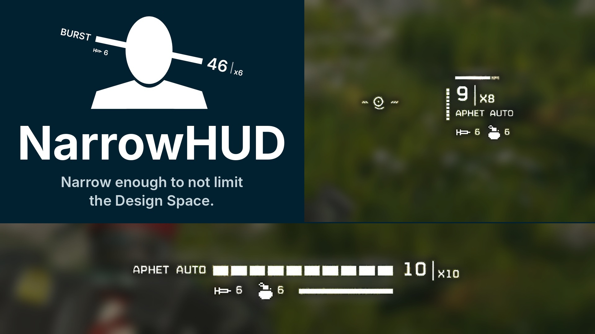

# NarrowHUD



*Narrow enough to not limit the Design Space.*

A small ammo and heat readout by your crosshair for Helldivers 2: the magazine in hand as a narrow bar, the count and
your spare magazines, plus your stims, grenades and backpack. It runs on
[Chef Shared Loader](https://github.com/Th3chef/Chef-Shared-Loader) **1.2.3 or newer** (older versions either block the
reads it needs or take some smaller missions for the ship, where NarrowHUD stays off).

## Make it your own: the layout editor

**[Open the NarrowHUD layout editor](https://luka189.github.io/NarrowHUD/editor/)** to place every part of the HUD
anywhere on the screen: drag the bar, the count, the magazines, the modes, stims, grenades and the backpack bar around a
game screen (or a screenshot of your own game, read in the browser only), make bars vertical or curved, and see how each kind of weapon will look. Then download (or copy) the file,
pick **Layout: Custom layout** in F9, and press the "Keys: reload layout file" key. The four built-in layouts are there
to start from, parts pin to each other so a layout holds together, and the Help button explains the rest. The file's
format is in [docs/LAYOUT.md](docs/LAYOUT.md) for editing by hand.

## Install

1. Install Chef Shared Loader (1.2.3 or newer) as its page says, with the highest priority in your mod manager.
2. Add the NarrowHUD zip in your mod manager and enable it.
3. Play. Settings are in the F9 menu, under NarrowHUD.

## What it shows

- **Ammo:** a tick per round for smaller magazines (up to 25 to 50 rounds by size; a solid bar above that), the count,
  and your spare magazines. Orange under a quarter, red when empty, dimmed while reloading. A tactical reload's
  chambered round gets a tick of its own.
- **Heat** (laser weapons, the Quasar, the Nova ...): the bar, the percentage, a mark at 75 %, red when overheated.
  Charge weapons fill up while they charge. The Double-Edge Sickle runs to 200 %, with marks at 50, 100 and 180.
  Cooling follows the planet (faster on cold ones).
- **Backpack weapons** (Autocannon, Recoilless, C4 ...): what's loaded and the spare ammo in the backpack. Weapons fed
  straight from a backpack show the backpack's ammo.
- **Underbarrels** (marked UB, or as the game names them: FLAME, 10G, 40MM HE), **fire modes** (AUTO, SEMI, BURST ...),
  **weapon modes** (GUIDED / UNGUIDED, APHET / FLAK, HEAT / HE ...) and the **rate of fire** for weapons with a
  setting; the modes as the **game's own icons** too, beside the stims. With a setting, each mode in its own colour
  (cream, blue or green), icons and words alike, so a switch is easy to see.
- **Lock-on** (Spear, WASP ...) and **charge meters** (Railgun, Epoch).
- **Stims, grenades** and how full your **backpack** is; the warp pack's heat, the jump pack's recharge, the hover
  pack's fuel and the shield backpack's strength (orange when low, red when broken).
- **Health and stamina** bars: always (the default), or only while they aren't full.
- A **stim timer**, **reload progress**, low-health **warnings**, and the HUD **out of the way** while you call in a
  stratagem, emote, open the weapon settings wheel or work a terminal.
- **Your map pin** and **where you last died** on the screen, where they are in the world, with their distance; an
  arrow at the screen's edge when one is out of view.
- A **drop line** for grenade launchers, rockets and plasma: the shot's flight, bending down, hidden where it enters
  the ground (while aiming down the sights by default; or whenever the weapon is in hand). It's aimed where the
  game's own reticle points, so it lags the view in a turn and sways with the sight as the reticle does (or along
  the view, an F9 choice), and it starts where the shot has fallen a set distance below a straight aim (10 cm by
  default), so a flat-shooting gun's line begins far out.
- A **throw line** for a stratagem ball, a grenade or C4: where the throw goes, while you aim it.
- A **landing mark** where a drop or throw line lands, painted on the ground (it lies on rocks, slopes and steps) with
  a chevron over it, from the map's own heights (the rocks, trees and props, calibrated by where Helldivers walk, and
  wherever you have looked, remembered per planet); faint where the ground is a guess. It turns **red** where the
  shot would hit a bug hole, a fabricator, a warp ship or an Illuminate tower.
- A **blast zone** under the mark for explosive rounds and grenades: the full-damage radius filled faintly with a
  bright rim, the outer radius as a dashed ring, red while you stand within reach. The lines are solid with dark
  edges and a fade-in at your hand; dashes that keep their size near and far, and the old plain line (Classic), are
  F9 choices.

Four built-in layouts: the **horizontal** stack (the bars under the crosshair), the **arcs** (centred on the
crosshair, the meters and the backpack inside), the **vertical pair** (the ammo bar standing right of the crosshair,
health on the left) and the **block** (one block right of the crosshair). Or **Custom**: your own, made in
the [layout editor](https://luka189.github.io/NarrowHUD/editor/).

## Settings (F9, NarrowHUD)

- Layout: four built-in ones (the horizontal stack, the arcs, the vertical pair, the block) or Custom: every part
  placed and styled on its own from a layout file, made in the [layout editor](https://luka189.github.io/NarrowHUD/editor/);
  size; one sideways and one up / down offset that moves any of them; Spread (the two sides of the crosshair closer
  or farther apart; the horizontal layout up or down as a whole) and how it changes while you aim; opacity.
- Motion: parts sliding, bars easing and one-shot pulses, resupplies lighting the magazines in order, mode words
  and icons fading over (off, quick or normal); a shell flash per round fired, and how far it flies; the same for
  each round loaded on weapons that load a round at a time (Shell loading); a stim timer, warning pulses (pulsing
  or one flash), the hit trail (what each hit took, in chunks or as one piece) and how long it stays, a reload line.
- Parts: a rule per part (the bar, the count, the spare magazines, the charge meter, the HEAT label, weapon and
  fire modes, the game's mode icons, the rate of fire, stims, the range, grenades, the backpack bar, health,
  stamina): off, always, while not full, on a change (for a few seconds), while aiming, or one of those joined
  with aiming.
- Visibility: how long a change shows, a part held back hidden or dimmed; the opacity while aiming; dimming or
  hiding when nothing has changed for a while; hiding while the stratagem key is held, during an emote, while the
  weapon settings wheel is open or a terminal is worked; and a key of your own that hides everything until
  pressed again (set it to the game's hide-HUD key and both go together).
- Look: the empty magazine squares shown or hidden; bar edges (none, an outline or the game's brackets) and the
  shade behind the bars (none, solid, or the game's hatching, drawn as one texture or stripe by stripe); the count's digits fixed (it never slides as it falls) or tight; the modes in their own
  colours; colours standard or colourblind (white, sky blue, yellow,
  magenta: told apart by brightness too); the share of a magazine that counts as low ammo (orange, with one
  flash). The HUD is drawn in the game's UI layer, so the colours are exact on every planet.
- Crosshairs: the sniper crosshair (while aiming or always; on the game's own aim point or static at the centre;
  and one for the Maxigun and, if you like, the flamethrowers in first person), and its size.
- Lines and marks: the map pin and death marker, the drop line (while aiming, whenever in hand, or off; its
  length, whether it follows the reticle or the view, and where it starts), the throw line, the landing mark, its
  size and the distance beside it, structure hits (the mark red where the shot goes into a bug hole, a fabricator,
  a warp ship, a nest, an emplacement's gun — shapes from the structures' own models), the lines' thickness,
  opacity and look (dashes, flowing dashes or Classic), the mark's look (on the ground or Classic) and the blast zone.
- Your fire button, swap keys, whether the mouse wheel swaps and the weapon options key, as you've bound them in the
  game (left mouse, 1 / 2 / 3, the wheel and R by default).
- Two keys to forget what NarrowHUD has learned: about the weapon in hand, or everything.
- A research log for bug reports, and running on a game version NarrowHUD wasn't made for.

## How it works (and what it can't do)

- It **only reads** game state, through Chef Shared Loader's crash-guarded calls. It never writes to the game.
- The game doesn't say which weapon is in your hand, so NarrowHUD reads your Helldiver's hand pose and learns which
  weapon goes with it the first time you fire. What was learned in testing ships with the mod, so most weapons show
  at once; a new one shows from its first shot. Two weapons held the same way (with a shield, say) are told apart by
  your swap keys.
- A shot counts as yours only within a moment of your fire button: as host, you own the soldiers' and some other
  objects too.
- After a game patch it checks its data against the game (on Chef 1.2 and newer) and leaves out anything that
  moved. If it can't check, it stays off and says so, rather than risk a crash.

**Known issues:** controllers (right trigger to fire, Y to swap) work on an Xbox-style pad; PlayStation pads are
untested, reports welcome. The Arc Thrower and the
Blitzer show no ammo (they have none); the Solo Silo's remote shows nothing.

## For developers

```
python3 tools/build.py            # build/NarrowHUD-v<version>.zip and build/narrowhud.lua
python3 tests/run_tests.py        # offline tests (lupa, Lua 5.1)
python3 tools/make_seed.py <learned file> [--drop ids]   # the shipped knowledge, src/learned_seed.lua
```

- `src/narrowhud.lua`: the head (header lines, version); `src/modules/NN_*.lua`: the mod, in modules (core, settings,
  learned, objects, hand, learning, weapon, draw_kit, beside, custom, under, research, main) that build.py puts
  together, each in its own function, sharing through a table N. `python3 tools/lint_globals.py` (also run by the
  tests) catches a name a module uses but doesn't have. `src/data_generated.lua`: the game object types and fields it reads, from the game's
  network config (`tools/parse_netcfg.py`, `tools/make_data.py`; the engine knows them only by a 32-bit hash, so the
  names are stand-ins with the same hashes, from `tools/crack_thin.c`). `src/learned_seed.lua`: the shipped knowledge.
- The learned file is `chef_data_luka189_2fnarrowhud__learned.lua` (Chef 1.0.0: `..._narrowhud_learned.lua`) in
  `%APPDATA%\Arrowhead\Helldivers2`; the log is `narrowhud.log` next to it (and `narrowhud_research.log` for the
  research rows' field dumps).
- After a game patch: [PATCHING.md](PATCHING.md). Release history: [CHANGELOG.md](CHANGELOG.md).
- The layout editor: `editor/editor.html` (one page, no build step; `tools/build.py` wraps it as `editor/index.html`
  for GitHub Pages). It draws the parts with the mod's own drawing code ported to JavaScript.

## Credits

- Weapon heat and charge values, stim durations, each projectile's speed, mass, drag and gravity: the [Helldivers 2 wiki](https://helldivers.wiki.gg).
- Uses research from [HD2Runtime by SkyeShade](https://github.com/SkyeShade/HD2Runtime): which armours have the Med-Kit and Adreno-Defibrillator passives (the stim timer), the projectiles' diameters and how the game flies them (the drop line), and the weapons' and grenades' blast radii (the blast zone).
- Painting on the ground with the game's own decal unit was first shown by Blast & Trajectory Markers (Nexus 18214) and HUD+; the idea only: NarrowHUD's code and ground pictures are its own.
- The under-the-crosshair look follows the "Bar" style of Reticle Ammo HUD; none of its code or assets is used here.
- The grenade icon was traced by dogo314 and is used with his permission. The stim icon, the all-barrels icon and the sniper crosshair (a
  tracing of the game's default reticle) are luka189's.
- Chef Shared Loader by Th3chef runs it; filediver (BSD) takes the network config out of the game files, its known-path lists name the map's units for the landing mark and the research log, and its unit exports give the structures' shapes the red mark tests (tools/make_shapes.py).

## License

Free to use, change and share; don't sell it or put it behind a paywall (donations and Donation Points are fine);
keep the credit. See [LICENSE](LICENSE).
Not affiliated with Arrowhead Game Studios.
