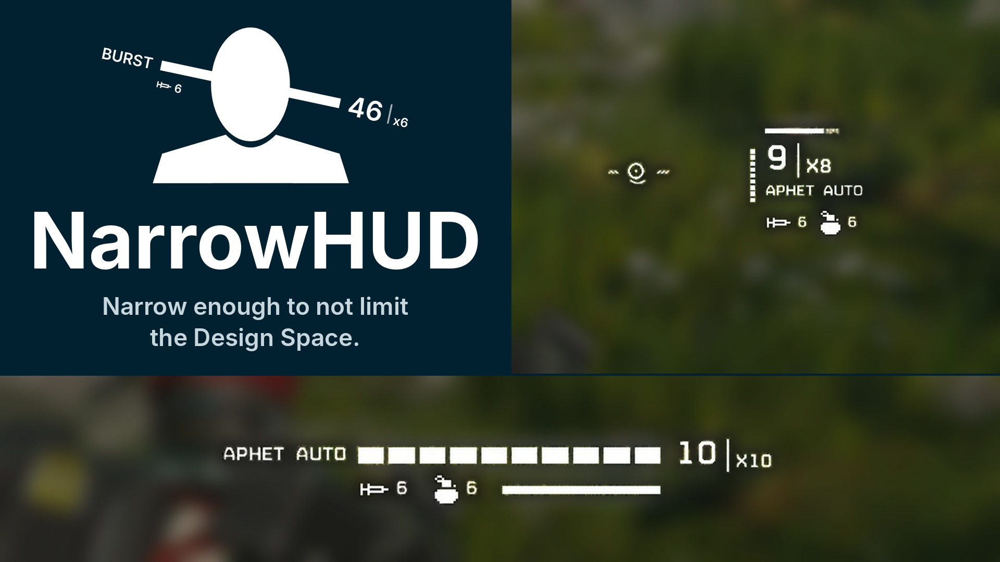

# NarrowHUD



*Narrow enough to not limit the Design Space.*

A small ammo and heat readout by your crosshair for Helldivers 2: the magazine in hand as a narrow bar, the count and
your spare magazines, plus your stims, grenades and backpack. It runs on
[Chef Shared Loader](https://github.com/Th3chef/Chef-Shared-Loader) **1.0.x or 1.2.3 and newer** (1.1 doesn't allow the
reads it needs; 1.2.0 to 1.2.2 take some smaller missions for the ship, and NarrowHUD stays off in them).

## Make it your own: the layout editor

**[Open the NarrowHUD layout editor](https://luka189.github.io/NarrowHUD/editor/)** to place every part of the HUD
anywhere on the screen: drag the bar, the count, the magazines, the modes, stims, grenades and the backpack bar around a
game screen, make bars vertical or curved, and see how each kind of weapon will look. Then download (or copy) the file,
pick **Position: Custom** in F9, and press the "Read the layout file again" key. Under, Beside and a curved pair are
there to start from. The file's format is in [docs/LAYOUT.md](docs/LAYOUT.md) for editing by hand.

## Install

1. Install Chef Shared Loader (1.0.x, or 1.2.3 or newer) as its page says.
2. Add the NarrowHUD zip in your mod manager and enable it.
3. Play. Settings are in the F9 menu, under NarrowHUD.

## What it shows

- **Ammo:** a tick per round for smaller magazines (up to 25 to 50 rounds by size; a solid bar above that), the count,
  and your spare magazines. Orange under a quarter, red when empty, dimmed while reloading. A tactical reload's
  chambered round gets a tick of its own.
- **Heat** (laser weapons, the Quasar, the Nova ...): the bar, the percentage, a mark at 75 %, red when overheated.
  Charge weapons fill up while they charge. The Double-Edge Sickle runs to 200 %, with marks at 50, 100 and 180.
  Cooling follows the planet (faster on cold ones).
- **Backpack weapons** (Autocannon, Recoilless, C4 ...): what's loaded and the spare ammo in the backpack. Weapons fed
  straight from a backpack show the backpack's ammo.
- **Underbarrels** (marked UB), **fire modes** (AUTO, SEMI, BURST ...), **weapon modes** (GUIDED / UNGUIDED, APHET /
  FLAK, HEAT / HE ...) and the **rate of fire** for weapons with a setting. With a setting, each mode in its own
  colour (cream, blue or green), so a switch is easy to see.
- **Lock-on** (Spear, WASP ...) and **charge meters** (Railgun, Epoch).
- **Stims, grenades** and how full your **backpack** is; the warp pack's heat and the jump pack's recharge.

Three built-in layouts: **under the crosshair** (a wide bar), **beside it** (a short vertical bar, the count, your
magazines as small squares), or **a screen corner** by the game's weapon panel (best with the bar and items turned
off). Or **Custom**: your own, made in the [layout editor](https://luka189.github.io/NarrowHUD/editor/).

## Settings (F9, NarrowHUD)

- Size; position (under or beside the crosshair, a screen corner by the game's weapon panel, or Custom: every part
  placed and styled on its own from a layout file, made in the [layout editor](https://luka189.github.io/NarrowHUD/editor/));
  one offset left / right and down / up that moves the built-in ones anywhere (a Custom layout only when its file
  says so).
- Every part shown or hidden on its own: the bar, the count, the spare magazines, the HEAT label, weapon modes, the
  fire mode, the rate of fire, the charge meter, stims, grenades, the backpack bar.
- Spare magazines beside and in the corner: squares or a number; the empty squares shown or hidden.
- Empty parts (of the ammo bar, the magazine squares, the backpack bar) faint, or as outlines.
- Opacity, and dimming or hiding when nothing has changed for a few seconds.
- Colours: standard, or colourblind (white, sky blue, yellow, magenta: told apart by brightness too).
- The game's font or a pixel font (Chef 1.0.x; from 1.1 on, Chef's own "Game font" setting does that for every mod).
- Your fire button, swap keys, whether the mouse wheel swaps and the weapon options key, as you've bound them in the
  game (left mouse, 1 / 2 / 3, the wheel and R by default).
- Two keys to forget what NarrowHUD has learned: about the weapon in hand, or everything.
- A research log for bug reports, and running on a game version NarrowHUD wasn't made for.

## How it works (and what it can't do)

- It **only reads** game state, through Chef Shared Loader's crash-guarded calls. It never writes to the game.
- The game doesn't say which weapon is in your hand, so NarrowHUD reads your Helldiver's hand pose and learns which
  weapon goes with it the first time you fire. What was learned in testing ships with the mod, so most weapons show
  at once; a new one shows from its first shot. Two weapons held the same way (with a shield, say) are told apart by
  your swap keys.
- A shot counts as yours only within a moment of your fire button: as host, you own the soldiers' and some other
  objects too.
- After a game patch it checks its data against the game (on Chef 1.0.x and 1.2+) and leaves out anything that
  moved. If it can't check, it stays off and says so, rather than risk a crash.

**Known issues:** controllers (right trigger to fire, Y to swap) work on an Xbox-style pad; PlayStation pads are
untested, reports welcome. The Arc Thrower and the
Blitzer show no ammo (they have none); the Solo Silo's remote shows nothing.

## For developers

```
python3 tools/build.py            # build/NarrowHUD-v<version>.zip and build/narrowhud.lua
python3 tests/run_tests.py        # offline tests (lupa, Lua 5.1)
python3 tools/make_seed.py <learned file> [--drop ids]   # the shipped knowledge, src/learned_seed.lua
```

- `src/narrowhud.lua`: the head (header lines, version); `src/modules/NN_*.lua`: the mod, in modules (core, settings,
  learned, objects, hand, learning, weapon, draw_kit, beside, custom, under, research, main) that build.py puts
  together, each in its own function, sharing through a table N. `python3 tools/lint_globals.py` (also run by the
  tests) catches a name a module uses but doesn't have. `src/data_generated.lua`: the game object types and fields it reads, from the game's
  network config (`tools/parse_netcfg.py`, `tools/make_data.py`; the engine knows them only by a 32-bit hash, so the
  names are stand-ins with the same hashes, from `tools/crack_thin.c`). `src/learned_seed.lua`: the shipped knowledge.
- The learned file is `chef_data_luka189_2fnarrowhud__learned.lua` (Chef 1.0.0: `..._narrowhud_learned.lua`) in
  `%APPDATA%\Arrowhead\Helldivers2`; the log is `narrowhud.log` next to it.
- After a game patch: [PATCHING.md](PATCHING.md). Release history: [CHANGELOG.md](CHANGELOG.md).
- The layout editor: `editor/editor.html` (one page, no build step; `tools/build.py` wraps it as `editor/index.html`
  for GitHub Pages). It draws the parts with the mod's own drawing code ported to JavaScript.

## Credits

- Weapon heat and charge values: the [Helldivers 2 wiki](https://helldivers.wiki.gg).
- The under-the-crosshair look follows the "Bar" style of Reticle Ammo HUD; none of its code or assets is used here.
- Chef Shared Loader by Th3chef runs it; filediver (BSD) takes the network config out of the game files.

## License

Free to use, change and share; don't sell it or put it behind a paywall (donations and Donation Points are fine);
keep the credit. See [LICENSE](LICENSE).
Not affiliated with Arrowhead Game Studios.
